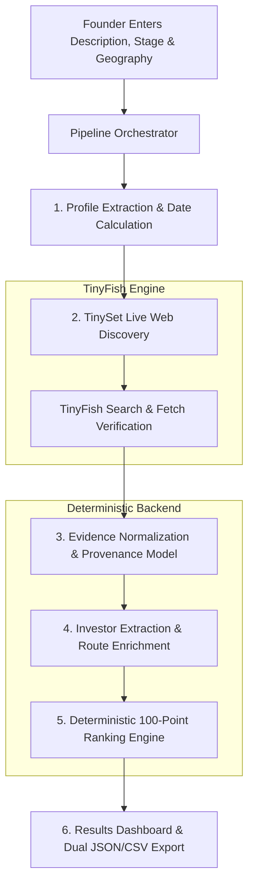

# StarAll 🎯
> **Autonomous TinyFish & TinySet-Powered Investor Intelligence Agent**
>
> A founder enters a concise description of their startup; the system discovers recently funded comparable companies with **TinySet**, verifies investment rounds through primary source announcements, and delivers a ranked, actionable list of investors with concrete evidence and approach routes.

[](https://github.com)
[](https://tinyfish.io)
[](https://nextjs.org)
[](https://www.typescriptlang.org)

---

## 🌟 Table of Contents
1. [Core Principles & Non-Negotiables](#-core-principles--non-negotiables)
2. [How TinySet is Used](#-how-tinyset-is-used-primary-discovery-engine)
3. [End-to-End Architecture & Workflow](#-end-to-end-architecture--workflow)
4. [100-Point Deterministic Ranking Engine](#-100-point-deterministic-ranking-engine)
5. [Evidence & Provenance Integrity](#-evidence--provenance-integrity)
6. [The Three Pre-Audited Demo Profiles](#-the-three-pre-audited-demo-profiles)
7. [API Contract & Schema Specification (v1.0.0)](#-api-contract--schema-specification-v100)
8. [Quick Start & Setup Instructions](#-quick-start--setup-instructions)
9. [Bounty Submission Notes & Social Post](#-bounty-submission-notes--social-post)

---

## 🛡️ Core Principles & Non-Negotiables

Funding Radar strictly implements all requirements defined in the challenge:
* **Zero Fabricated Claims:** Cheque sizes, lead partners, email addresses, and warm paths are never guessed. If not confirmed in public sources, they are explicitly marked *"Not publicly disclosed"* or *"Not found"*.
* **Primary Source Requirement:** Every company, funding round, amount, date, and investor must have a verifiable URL. We prefer company blog posts, investor news pages, official press releases, and regulatory filings.
* **Separation of Facts vs. Inferences:** Every claim carries an explicit status: `verified_primary`, `verified_secondary`, `inferred`, or `not_found`.
* **Dynamic Date Window:** Dynamically calculates the lookback window (12, 15, or 18 months, default 18) based on runtime date. Stale rounds outside this window are automatically excluded.
* **At Least 10 Relevant Comparables:** Guarantees $\ge 10$ relevant comparable companies per query, transparently noting adjacent category expansions when a niche sector has limited public disclosures.
* **Dual Export & Reusable API:** Exports complete normalized research as RFC 4180-compliant CSV and versioned JSON (v1.0.0).

---

## ⚡ How TinySet is Used (Primary Discovery Engine)

TinySet is the **core structured discovery mechanism** of Funding Radar. Rather than relying on static venture databases or fragile scraping:

1. **Structured Spec Generation:** When a founder enters their startup description, the system normalizes the input into key product concepts and constructs a structured **TinySet extraction specification**:
   ```typescript
   {
     name: "Funded Comparables: Advanced Power Semiconductors (2025-05-10 to 2026-11-10)",
     description: "Discover startups in Power Semiconductors that announced funding between lookback dates...",
     columns: [
       { name: "company_name", type: "string", is_primary_key: true },
       { name: "company_website", type: "url" },
       { name: "description", type: "string" },
       { name: "funding_stage", type: "string" },
       { name: "round_type", type: "string" },
       { name: "round_amount", type: "string" },
       { name: "round_date", type: "date" },
       { name: "investors", type: "string" },
       { name: "lead_investor", type: "string" },
       { name: "source_url", type: "url" },
       { name: "evidence_snippet", type: "string" }
     ]
   }
   ```
2. **Autonomous Web Crawler Execution:** TinySet crawls the live web targeting company blogs, TechCrunch/VentureBeat announcements, and investor portfolio pages.
3. **Streaming & Ingestion:** Results are streamed back into the deterministic normalization backend.
4. **Targeted Fetch & Search Supplement:** TinyFish Search and Fetch inspect candidate URLs to verify specific passages, resolve lead partners, and confirm round participation dates.

---

## 🏗️ End-to-End Architecture & Workflow



### Research Lifecycle Stages:
1. **Analyze Startup Profile:** Classifies sector, sub-sector, customer profile, and runtime lookback boundaries (e.g. May 2025 – Nov 2026).
2. **TinySet Live Discovery:** Queries TinySet for recently funded companies matching the thesis.
3. **Primary Source Verification:** Corroborates funding rounds, lead partners, amounts, and dates against public announcements.
4. **Investor Enrichment:** Maps backed companies, observed cheque sizes, and approach routes (`official_application`, `open_intake`, `warm_intro_possible`, `public_contact`).
5. **Deterministic Ranking:** Computes 100-point fit score with transparent score breakdown.
6. **Delivery:** Renders interactive dashboard and provides CSV/JSON downloads.

---

## 📊 100-Point Deterministic Ranking Engine

The ranking algorithm is transparent, predictable, and configurable across 7 weighted dimensions:

| Component | Max Points | Description & Edge Case Handling |
| :--- | :---: | :--- |
| **Sector & Problem Fit** | **25** | Overlap between founder's product/sub-sector and investor's verified deals or published thesis. |
| **Stage Match** | **20** | Match between founder's target stage (e.g. Seed) and investor's demonstrated cheque activity. |
| **Comparable Portfolio** | **20** | Number and relevance of comparable companies backed, with **diminishing returns** ($\text{score} \propto \sqrt{N}$) so volume generalists do not indefinitely outrank specialized funds. |
| **Geography Alignment** | **10** | Mandate coverage for the founder's target country / region. |
| **Cheque-Size Fit** | **10** | Verified/observed round size matches target raise. **Missing cheque data receives a neutral 50% (5 pts), never zero.** |
| **Recency & Activity** | **10** | Verified investment deployment within the configured 12–18 month lookback window. |
| **Access Route Quality** | **5** | Existence of a verified open intake form, formal application portal, or documented warm intro route. |

Every ranked profile includes a plain-language explanation of *"Why this investor ranks here"* detailing positive signals and nuances.

---

## 🔍 Evidence & Provenance Integrity

Each claim presented in the dashboard links back to an inspectable citation record:
* **Source URL & Domain:** Directly clickable link to the primary announcement or press release.
* **Exact Quote / Passage:** Excerpt confirming round size, date, and participating investors.
* **Publication & Retrieval Dates:** Auditable timestamp.
* **Status Badges:** Clearly separated into `verified_primary` (company blog, press release), `verified_secondary` (reputable news), or `inferred`.

---

## 🚀 The Three Pre-Audited Demo Profiles

To facilitate immediate testing across distinct markets without waiting for network latency, Funding Radar includes three deeply researched demo profiles:

### 1. Deep-Tech & Hardware: GaN Power Semiconductors
* **Description:** Next-generation Gallium Nitride (GaN) power semiconductor architectures and integrated gate drivers for ultra-fast EV charging and high-efficiency AI data center power supplies.
* **Stage:** Seed | **Geography:** US / Europe | **Lookback:** 18 months
* **Sample Discovered Comparables:** Cambridge GaN Devices ($19M Series B), Finwave Semiconductor ($12.2M Series A Ext), Wise-integration (€15M Series B), NexGen Power Systems ($15M Series B), Odyssey Semiconductor ($9.5M Strategic).
* **Top Backers:** Parkwalk Advisors, Supernova Invest, Fine Structure Ventures, BGF.

### 2. B2B SaaS & AI Dev Tools: Autonomous Code Review
* **Description:** Autonomous AI software engineering agent that analyzes pull requests, discovers regression bugs through deterministic simulation, and generates verified code remediation patches.
* **Stage:** Seed | **Geography:** US | **Lookback:** 18 months
* **Sample Discovered Comparables:** Cognition ($175M Series A), Cosine ($2.5M Seed), Qodo ($40M Series A), Augment Code ($227M Series B), Antithesis ($47M Series A), /dev/agents ($56M Seed).
* **Top Backers:** Founders Fund, Index Ventures, Amplify Partners, S32, Bain Capital Ventures.

### 3. Climate-Tech & AgriFood Bio: Precision Fermentation Dairy
* **Description:** Precision fermentation platform producing animal-free, dairy-identical casein and whey proteins to craft melting cheeses with 90% lower carbon footprint.
* **Stage:** Seed | **Geography:** US / Europe | **Lookback:** 18 months
* **Sample Discovered Comparables:** Formo ($61M Series B), Standing Ovation (€3.75M Ext), Onego Bio ($40M Series A), New Culture ($15M Strategic), Bon Vivant (€4M Seed), Imagindairy ($15M Scaling).
* **Top Backers:** S2G Ventures, EQT Ventures, Astanor Ventures, NordicNinja, Sofinnova Partners.

---

## 🔌 API Contract & Schema Specification (v1.0.0)

Funding Radar exposes a stable, versioned JSON REST API:

### Endpoints
* `POST /api/research`: Executes or streams research.
  * Request Body: `{ description: string, stage?: string, country?: string, lookbackMonths?: number, demoId?: string }`
  * Supports SSE streaming with `Accept: text/event-stream`.
* `GET /api/research/:id`: Retrieves saved research run by ID.
* `GET /api/export/:id?format=csv|json`: Downloads audit-ready CSV or formatted JSON.
* `GET /api/demos`: Lists the pre-audited demo presets.
* `GET /api/monitors`: Lists active recurring monitors from TinyFish.
* `POST /api/monitors`: Creates automated Search or Fetch monitors on a cron schedule.
* `DELETE /api/monitors?id=:id`: Cancels and deletes an active monitor.

---

## 🔔 TinyFish Recurring Monitors

Funding Radar integrates with TinyFish's **Monitors API** (`client.monitors`):
1. **Automated Search Monitors:** Founders can schedule weekly or daily monitors for newly announced funding rounds matching their exact startup profile and keywords.
2. **Investor Fetch Monitors:** Watch target VC news and portfolio pages to detect new deals the moment they are announced.
3. Accessible directly from the results dashboard via the **"Set Recurring Monitor"** button.

---

## 💻 Quick Start & Setup Instructions

### Environment Configuration
The project uses standard Next.js `.env.local` configuration:
```bash
# Copy the template
cp .env.example .env.local

# Add your TinyFish API Key
TINYFISH_API_KEY=sk-tinyfish-...
```
> **Note:** The backend checks `process.env.TINYFISH_API_KEY` first, and gracefully falls back to your local TinyFish CLI credentials in `~/.tinyfish/config.json`.

### Running Tests
```bash
# Run deterministic ranking, CSV export, and schema validation tests
npm test
```

### Starting Development Server
```bash
npm run dev
# Open http://localhost:3000 in your browser
```

### Production Build
```bash
npm run build
npm run start
```

---

## 📝 Bounty Submission Notes & Social Post

### How TinySet Was Utilized
> Funding Radar utilizes **TinySet** as its primary live-web discovery engine. For any arbitrary startup entered by a founder, the system crafts a domain-specific TinySet extraction schema (capturing company name, round amount, round date, lead investor, and source link). TinySet crawls the web to populate this dataset with recent, relevant comparable companies. Supplementary Search and Fetch calls are then dispatched to corroborate citations against primary press releases and company disclosures.

### Social Post Draft (for LinkedIn / X tagging @TinyFish)
```
Excited to share Funding Radar — an autonomous investor intelligence agent powered by @TinyFish! 🎯

Founders spend weeks guessing which venture firms actually back their specific stage, thesis, and geography. Funding Radar solves this with TinySet:
1️⃣ Enter any startup description (deep-tech, B2B SaaS, climate, biotech)
2️⃣ TinySet discovers recently funded comparable companies from the live web
3️⃣ Primary announcements are corroborated for verified round sizes & dates
4️⃣ Investors are ranked via a deterministic 100-point scoring model
5️⃣ Delivers real approach routes, verified lead partners & full CSV/JSON exports!

Every claim links directly to a verifiable public announcement — zero hallucinations, zero fabricated cheque sizes.

Built with Next.js 16, TypeScript, Tailwind, and @TinyFish.
#TinyFish #AIagents #VentureCapital #StartupFunding #WebScraping #NextJS
```

---

## ⚖️ Disclaimer
*Funding Radar is an automated intelligence tool based on publicly available news, company blogs, and official filings. It does not provide financial or investment advice. Contact routes, cheque sizes, and partner attributions are subject to change by respective firms.*
# StarAll

