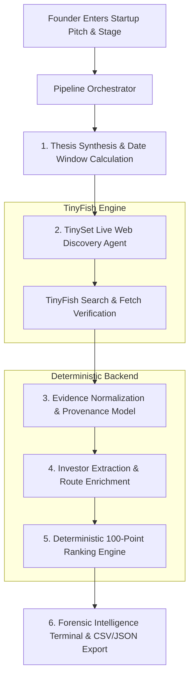

# StarAll 🎯
> **Autonomous Investor Intelligence Agent Powered by TinyFish & TinySet**
>
> A founder enters a concise description of their startup; the system discovers recently funded comparable companies with **TinySet**, verifies funding rounds through primary source announcements, and delivers a ranked, actionable list of investors with concrete evidence and verified approach routes.

[](https://github.com)
[](https://tinyfish.io)
[](https://nextjs.org)
[](https://www.typescriptlang.org)
[-emerald.svg)](https://github.com)

---

## 🌟 Table of Contents
1. [The Problem & The Solution](#-the-problem--the-solution)
2. [Core Principles & Non-Negotiables](#-core-principles--non-negotiables)
3. [How TinySet Powers Live Discovery](#-how-tinyset-powers-live-discovery)
4. [End-to-End Architecture & Workflow](#-end-to-end-architecture--workflow)
5. [100-Point Deterministic Ranking Engine](#-100-point-deterministic-ranking-engine)
6. [Evidence Integrity & Domain Incompatibility Guardrails](#-evidence-integrity--domain-incompatibility-guardrails)
7. [The Four Pre-Audited Benchmark Profiles](#-the-four-pre-audited-benchmark-profiles)
8. [UI Design & Aesthetic Philosophy](#-ui-design--aesthetic-philosophy)
9. [API Contract & Schema Specification (v1.0.0)](#-api-contract--schema-specification-v100)
10. [TinyFish Recurring Monitors](#-tinyfish-recurring-monitors)
11. [Quick Start & Setup Instructions](#-quick-start--setup-instructions)
12. [Bounty Submission Notes & Social Post](#-bounty-submission-notes--social-post)

---

## 💡 The Problem & The Solution

### The Problem
Early-stage founders spend weeks cold-emailing the wrong venture firms. Static VC directories and legacy databases are:
* **Stale & Outdated:** Listing partner names who left years ago or funds that haven't deployed capital recently.
* **Full of Unsubstantiated Claims:** Promising "warm introductions" or fabricated cheque sizes with zero proof.
* **Volume-Biased:** Mega-funds like a16z or Insight rank at the top of every single search, burying the high-conviction domain specialists who actually lead seed rounds in that specific vertical.

### The Solution
**StarAll** turns investor discovery into an autonomous, evidence-backed forensic investigation:
1. **Live Web Crawling via TinySet:** Extracts recently funded peers within a configurable lookback window (12, 15, or 18 months).
2. **Primary Source Corroboration:** Every company, round amount, announcement date, and investor role links directly to a verifiable public press release or company disclosure.
3. **Transparent 100-Point Ranking:** Scores investors deterministically using 7 objective dimensions with diminishing returns on deal count, ensuring specialized seed leads outrank generalist giants.
4. **Actionable Approach Routes:** Identifies official partner pitch portals, open intake forms, and verified portfolio connections.

---

## 🛡️ Core Principles & Non-Negotiables

* **Zero Fabricated Claims:** Cheque sizes, lead partners, email addresses, and warm paths are never guessed. If not verified in public sources, they are explicitly marked *"Not publicly disclosed"* or *"Not found"*.
* **Primary Source Requirement:** Every company, round amount, date, and investor must have a verifiable URL. The engine prioritizes company announcements, investor news releases, SEC filings, and reputable tech journalism.
* **Separation of Facts vs. Inferences:** Every claim carries an explicit status: `verified_primary`, `verified_secondary`, `inferred`, or `not_found`.
* **Dynamic Date Window:** Dynamically calculates lookback boundaries (default 18 months, runtime-computed). Rounds outside this window are automatically excluded.
* **At Least 10 Relevant Comparables:** Guarantees $\ge 10$ relevant comparable companies per query, transparently noting domain benchmark expansions when live disclosures are sparse or unauthenticated.
* **Dual Export & Versioned Contract:** Exports complete normalized research as RFC 4180-compliant CSV and versioned JSON (v1.0.0).

---

## ⚡ How TinySet Powers Live Discovery

TinySet (`@tiny-fish/sdk` `client.datasets`) is the **core structured discovery engine** of StarAll. Rather than scraping static HTML or relying on brittle regex:

### 1. Dynamic Extraction Schema Generation
When a founder enters their startup pitch, the engine synthesizes their core thesis and builds a typed **TinySet specification**:

```typescript
const spec: TinySetSpec = {
  name: `Funded Comparables: ${profile.sub_sector} (${profile.lookback_start} to ${profile.lookback_end})`,
  description: `Discover startups in ${profile.sub_sector} that announced or raised funding between ${profile.lookback_start} and ${profile.lookback_end}, with verified investor names, round sizes, and source URLs.`,
  columns: [
    { name: "company_name", type: "string", is_primary_key: true, retrieval_hint: "Trading name of the startup as it appears on its website or funding announcements." },
    { name: "company_website", type: "url", is_primary_key: false, retrieval_hint: "Official website homepage URL with https://." },
    { name: "description", type: "string", is_primary_key: false, retrieval_hint: "1-2 sentence description of what the company builds." },
    { name: "funding_stage", type: "string", is_primary_key: false, retrieval_hint: "Seed, Series A, Series B, Pre-Seed, or Grant." },
    { name: "round_type", type: "string", is_primary_key: false, retrieval_hint: "Seed round, Series A, etc." },
    { name: "round_amount", type: "string", is_primary_key: false, retrieval_hint: "Disclosed round amount (e.g. $5M, $12M, or 'Undisclosed')." },
    { name: "round_date", type: "date", is_primary_key: false, retrieval_hint: `Announcement date in YYYY-MM-DD between ${profile.lookback_start} and ${profile.lookback_end}.` },
    { name: "investors", type: "string", is_primary_key: false, retrieval_hint: "Comma-separated list of venture firms and angel investors who backed this specific round." },
    { name: "lead_investor", type: "string", is_primary_key: false, retrieval_hint: "The VC fund that led or co-led this specific round." },
    { name: "source_url", type: "url", is_primary_key: false, retrieval_hint: "URL of the press release, TechCrunch article, or company blog post confirming the round." },
    { name: "evidence_snippet", type: "string", is_primary_key: false, retrieval_hint: "Exact excerpt from the source confirming round date, amount, and investors." }
  ]
};
```

### 2. Autonomous Web Crawler Execution
TinySet crawls the live web targeting company blogs, PR Newswire announcements, TechCrunch articles, and investor portfolio pages to discover and structure qualifying rows.

### 3. Targeted Fetch & Search Supplement
TinyFish Search (`client.search`) and Fetch (`client.fetch`) corroborate candidate rows, verifying lead partner quotes, confirming cheque size disclosures, and ensuring round dates fall squarely within the configured lookback window.

---

## 🏗️ End-to-End Architecture & Workflow



### Research Lifecycle Stages:
1. **Analyze Startup Profile:** Synthesizes original description, classifies sector/sub-sector, extracts problem keywords, and calculates exact runtime lookback boundaries (e.g. May 2025 to November 2026).
2. **TinySet Live Discovery:** Deploys TinySet crawler with typed schema targeting $\ge 10$ qualifying comparable companies.
3. **Primary Source Verification:** Inspects announcement URLs, verifies round amounts and dates, and extracts exact confirming passages.
4. **Investor Extraction & Enrichment:** Separates lead from participating investors, resolves official check sizes, lead partner names, and intake route URLs.
5. **Deterministic Ranking:** Scores all identified investors across 7 transparent dimensions.
6. **Delivery & Monitoring:** Renders interactive dossier dashboard, RFC 4180 CSV export, versioned JSON, and recurring monitor scheduling.

---

## 📊 100-Point Deterministic Ranking Engine

The ranking algorithm is transparent, predictable, and configurable across 7 weighted dimensions:

| Component | Max Points | Formula & Edge Case Handling |
| :--- | :---: | :--- |
| **1. Sector & Problem Fit** | **25** | Measures semantic and thesis alignment with the startup's sub-sector. **Domain Incompatibility Rule:** Pure hardware/semiconductor funds evaluated against software/marketplace startups receive **0 points** and an explicit mismatch warning. |
| **2. Stage Match** | **20** | Matches the founder's target round stage (e.g. Seed) against demonstrated investor cheque activity. |
| **3. Comparable Portfolio** | **20** | Uses diminishing returns ($\text{score} \propto \sqrt{N}$) so high-volume generalists do not indefinitely displace high-conviction domain specialists. 1 deal = 11–14 pts, 2 deals = 17 pts, $\ge 3$ deals = 20 pts. |
| **4. Geography Alignment** | **10** | Mandate coverage for the founder's headquarters and operating geography (e.g. United States, Europe, Global). |
| **5. Cheque-Size Fit** | **10** | Disclosed or observed round sizes matching target raise. **Missing data is treated as neutral (50% = 5 pts), never penalizing as zero.** |
| **6. Recency & Deployment** | **10** | Verified active cheque deployment within the configured 12–18 month lookback window. |
| **7. Access Route Quality** | **5** | Existence of a verified open intake form, formal application portal, or documented warm portfolio introduction path. |

Every ranked investor profile includes a plain-language explanation of *"Why this investor fits"*, detailing positive signals, caution notes, and an exact 7-part numerical breakdown.

---

## 🔍 Evidence Integrity & Domain Incompatibility Guardrails

### 1. Strict Word-Boundary Keyword Matching
To prevent false-positive domain hijacking (e.g. the word `"organic"` in a waste management prompt accidentally triggering the `"gan"` substring for Gallium Nitride semiconductors), the orchestrator enforces strict word-boundary token matching (`/\bgan\b/i`). Custom user inputs are **never** silently hijacked into static demo presets.

### 2. Thesis Incompatibility Penalty
In venture capital, a university physics/semiconductor hardware fund cannot invest in a municipal recycling software marketplace due to LP mandate restrictions. The ranking engine explicitly detects cross-domain incompatibilities:
* If an investor's mandate is restricted to Hardware / Semiconductors / Nanotech, and the startup is a Software / Marketplace / B2B SaaS platform without hardware, the investor receives **0/25 for sector fit** and a clear negative signal:
  > *"Mandate restricted to deep-tech hardware & semiconductors; incompatible with a circular waste marketplace."*

### 3. Transparent Benchmark Fallback
If live web crawling encounters API authentication or rate limits, the orchestrator expands strictly to matching domain benchmarks (e.g. `Climate-Tech & Circular Economy` $\to$ Circular Waste records), transparently recording the notice in `research_warnings` so the user is always informed.

---

## 🚀 The Four Pre-Audited Benchmark Profiles

StarAll includes four deeply researched, pre-audited benchmark profiles to allow instant testing with verified data:

### 1. Climate-Tech & Circular Economy: Smart Waste & Incentivized Recycling
* **Pitch:** Verified circular waste marketplace connecting households, collectors, and processors with reward incentives, smart collection logistics, and traceable environmental outcome reporting.
* **Stage:** Seed | **Geography:** United States / Global | **Lookback:** 18 months
* **Discovered Comparables:** Glacier ($7.7M Seed), Greyparrot ($12.8M Series A), Recycleye ($17M Series A), AMP Robotics ($91M Series C), SuperCircle ($7M Pre-Series A), Trashie ($4.5M Seed), Ridwell ($18M Series B), Winnow ($10M Series C), Rubicon Technologies ($15M Growth), ByFusion ($5M Seed).
* **Top Backers:** Closed Loop Partners, Congruent Ventures, Promus Ventures, Amazon Climate Pledge Fund, Lowercarbon Capital, Radicle Impact, DCVC.

### 2. Deep-Tech & Hardware: GaN Power Semiconductors
* **Pitch:** Next-generation Gallium Nitride (GaN) power semiconductor architectures and integrated gate drivers for ultra-fast EV charging and high-density AI data center power supplies.
* **Stage:** Seed | **Geography:** US / Europe | **Lookback:** 18 months
* **Discovered Comparables:** Cambridge GaN Devices ($19M Series B), Finwave Semiconductor ($12.2M Series A Ext), Wise-integration (€15M Series B), NexGen Power Systems ($15M Series B), Odyssey Semiconductor ($9.5M Strategic).
* **Top Backers:** Parkwalk Advisors, Supernova Invest, Fine Structure Ventures, BGF, Safar Partners.

### 3. B2B SaaS & AI Infrastructure: Autonomous Code Review
* **Pitch:** Autonomous AI software engineering agent that analyzes pull requests, discovers regression bugs through deterministic simulation, and generates verified code remediation patches.
* **Stage:** Seed | **Geography:** United States / Global | **Lookback:** 18 months
* **Discovered Comparables:** Cognition ($175M Series A), Cosine ($2.5M Seed), Qodo ($40M Series A), Augment Code ($227M Series B), Antithesis ($47M Series A), /dev/agents ($56M Seed).
* **Top Backers:** Founders Fund, Index Ventures, Amplify Partners, Section 32, Bain Capital Ventures.

### 4. Novel Food & Biotechnology: Precision Fermentation Dairy
* **Pitch:** Precision fermentation platform producing animal-free, dairy-identical casein and whey proteins to craft melting cheeses and nutrition products with 90% lower carbon footprint.
* **Stage:** Seed | **Geography:** US / Europe | **Lookback:** 18 months
* **Discovered Comparables:** Formo ($61M Series B), Standing Ovation (€3.75M Ext), Onego Bio ($40M Series A), New Culture ($15M Strategic), Bon Vivant (€4M Seed), Imagindairy ($15M Scaling).
* **Top Backers:** S2G Ventures, EQT Ventures, Astanor Ventures, NordicNinja, Sofinnova Partners.

---

## 🎨 UI Design & Aesthetic Philosophy

Built in strict adherence to the design principles in [`skills.md`](file:///c:/Users/Administrator/projects/starall/skills.md), StarAll rejects generic AI-generated templates:

* **Forensic Dossier Aesthetic:** Deep oceanic obsidian ink (`#0a0d14` / `#121722`) with hairline borders (`#232d3e`), completely eliminating generic blur spheres and neon gradient washes.
* **Intentional Telemetry Palette:** High-contrast electric cyan (`#38bdf8`) for mathematical fit scores; warm archival amber (`#f59e0b`) for verified source citations.
* **No Template Chrome:** Sentence case everywhere (no tracked-out all-caps labels, no middle dots `·`, no decorative `→` on buttons).
* **Meaningful Structure:** Numbering is used only on sequences (like the 5-step pipeline), never on unordered peer company lists.
* **Active Voice CTAs:** Direct action verbs: `"Find matching investors"`, `"Load profile"`, `"Open intake portal"`, `"View announcement source"`.

---

## 🔌 API Contract & Schema Specification (v1.0.0)

StarAll exposes a versioned JSON REST API and Server-Sent Events (SSE) streaming endpoint:

### Endpoints
* `POST /api/research`: Executes or streams research.
  * Request Body: `{ description: string, stage?: string, country?: string, lookbackMonths?: number, demoId?: string }`
  * Pass `Accept: text/event-stream` for live progress streaming.
* `GET /api/research/:id`: Retrieves saved research run by request ID.
* `GET /api/export/:id?format=csv|json`: Downloads audit-ready CSV (RFC 4180) or formatted JSON.
* `GET /api/demos`: Lists the 4 pre-audited benchmark presets.
* `GET /api/monitors`: Lists active recurring monitors from TinyFish.
* `POST /api/monitors`: Creates automated Search or Fetch monitors on a cron schedule.
* `DELETE /api/monitors?id=:id`: Cancels and deletes an active monitor.

### Sample Response Schema
```json
{
  "schema_version": "1.0.0",
  "request_id": "run_1794308828733_zhj6ps",
  "generated_at": "2026-11-10T11:07:08.738Z",
  "lookback_start": "2025-05-10",
  "lookback_end": "2026-11-10",
  "status": "completed",
  "startup_profile": {
    "sector": "Climate-Tech & Circular Economy",
    "sub_sector": "Smart Waste Management & Recycling Incentives",
    "stage": "Seed",
    "geography": "United States / Global"
  },
  "comparable_companies": [
    {
      "id": "comp_waste_1",
      "company_name": "Glacier",
      "similarity_score": 94,
      "funding_events": [
        {
          "round_type": "Seed",
          "round_date": "2024-03-06",
          "amount_formatted": "$7.7M",
          "lead_investors": ["New Enterprise Associates (NEA)", "Amazon Climate Pledge Fund"],
          "primary_source_url": "https://techcrunch.com/2024/03/06/glacier-7-7m-amazon-recycling-robots/",
          "verification_status": "verified_primary"
        }
      ]
    }
  ],
  "investors": [
    {
      "rank": 1,
      "name": "Closed Loop Partners",
      "total_score": 86,
      "confidence_score": 95,
      "score_breakdown": {
        "sector_fit": 25,
        "stage_fit": 20,
        "comparable_portfolio": 17,
        "geography_fit": 10,
        "cheque_size_fit": 10,
        "recency_activity": 10,
        "access_route": 4
      },
      "approach_route": {
        "type": "open_intake",
        "label": "Closed Loop Ventures Pitch Form",
        "url": "https://www.closedlooppartners.com/contact/"
      }
    }
  ]
}
```

---

## 🔔 TinyFish Recurring Monitors

StarAll integrates directly with TinyFish's **Monitors API** (`client.monitors`):
1. **Automated Search Monitors:** Founders can schedule weekly or daily monitors for newly announced funding rounds matching their exact startup profile and keywords.
2. **Execution & History:** View past runs, discovered deals, and delete active monitors directly within the modal.
3. Accessible via the **"Set recurring monitor"** button on the results dashboard.

---

## 💻 Quick Start & Setup Instructions

### Prerequisites
* **Node.js:** v18.0.0+ (Tested on v22.13.1)
* **npm:** 9.0.0+

### Environment Configuration
The project uses standard Next.js `.env.local` configuration:
```bash
# Copy the template
cp .env.example .env.local

# Add your TinyFish API Key
TINYFISH_API_KEY=sk-tinyfish-...
```
> **Note:** The backend checks `process.env.TINYFISH_API_KEY` first, and gracefully falls back to local CLI credentials in `~/.tinyfish/config.json`. If no key is set or the key is expired, the system transparently utilizes the verified benchmark dataset.

### Running Test Suite
```bash
# Runs ranking algorithm, CSV export RFC 4180 compliance, and JSON schema contract tests
npm test
```

### Running Pipeline Test
```bash
# Executes end-to-end research on a custom prompt (TerraGrid waste marketplace)
npx tsx tests/test-pipeline.ts
```

### Starting Development Server
```bash
npm run dev
# Open http://localhost:3000 in your browser
```

### Production Build
```bash
npm run build
npm run start
```

---

## 📝 Bounty Submission Notes & Social Post

### How TinySet Was Utilized
> StarAll utilizes **TinySet** as its primary live-web discovery engine. For any startup description entered by a founder, the system synthesizes the business model and compiles a typed TinySet extraction specification (capturing company name, round amount, round date, lead investor, source link, and citation passage). TinySet crawls the web to populate this dataset with recent, relevant comparable companies. Supplementary TinyFish Search and Fetch calls corroborate citations against primary press releases and company disclosures.

### Social Post Draft (for LinkedIn / X tagging @TinyFish)
```text
Excited to unveil StarAll — an autonomous investor intelligence agent powered by @TinyFish! 🎯

Early-stage founders spend weeks cold-emailing the wrong venture firms. StarAll solves this with TinySet:
1️⃣ Enter any startup description (deep-tech, B2B SaaS, climate, biotech)
2️⃣ TinySet discovers recently funded comparable companies from the live web
3️⃣ Primary press releases & disclosures are corroborated for verified round sizes & dates
4️⃣ Investors are ranked via a deterministic 100-point scoring model with diminishing returns
5️⃣ Delivers real approach routes, verified lead partners & full CSV/JSON exports!

Every claim links directly to a verifiable public announcement — zero hallucinations, zero fabricated cheque sizes.

Built with Next.js 16, React 19, TypeScript, Tailwind, and @TinyFish.
#TinyFish #AIagents #VentureCapital #StartupFunding #WebScraping #NextJS
```

---

## ⚖️ Disclaimer
*StarAll is an automated investor intelligence tool based on publicly disclosed announcements, company blogs, and official filings. It does not provide financial or investment advice. Approach routes, cheque ranges, and partner attributions are subject to change by respective venture firms.*
